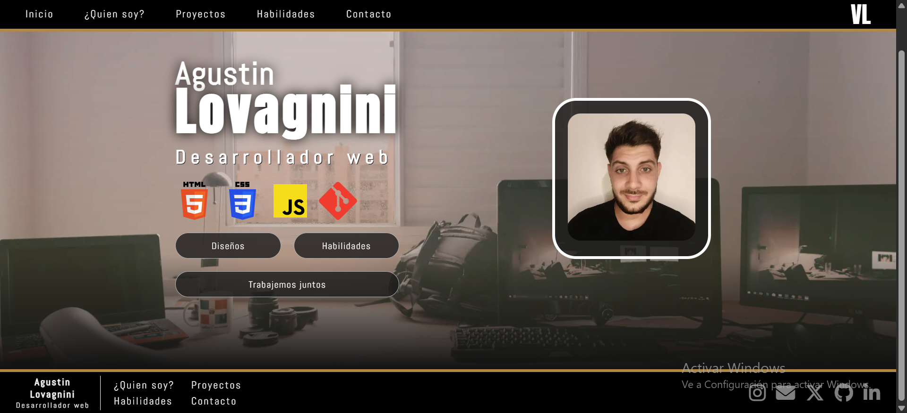
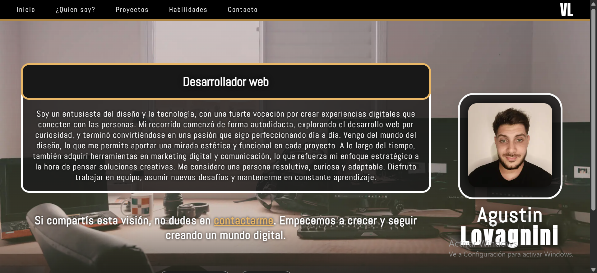
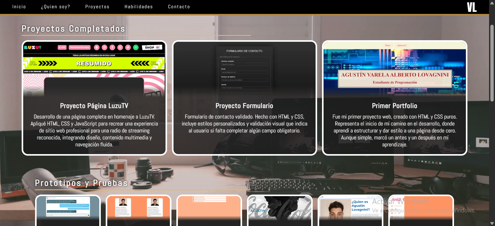
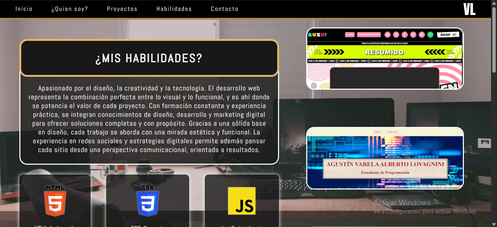
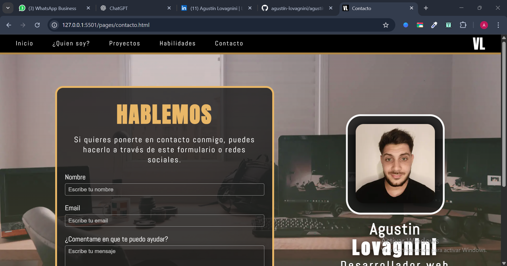

> [!IMPORTANT]
> **Portfolio anterior — Proyecto histórico**
>
> Este proyecto corresponde a una versión anterior de mi CV web, desarrollada con HTML, CSS y Sass (SCSS).
>
> Actualmente estoy desarrollando una nueva versión de mi portfolio profesional con **Next.js, React, TypeScript y Tailwind CSS v4**, incorporando los conocimientos adquiridos durante mi formación como desarrollador Full Stack.
>
> Conservo este repositorio como parte de mi evolución profesional y para mostrar mis primeros trabajos y conocimientos en desarrollo frontend.
>
> **Nuevo repositorio:** [agustin-lovagnini-cv](https://github.com/agustin-lovagnini/agustin-lovagnini-cv)
>
> *La nueva versión se encuentra en desarrollo.*

---

# 📌 CV - Agustín Alberto Varela Lovagnini

Este repositorio contiene mi currículum web, un sitio personal que desarrollé aplicando buenas prácticas de desarrollo con HTML, SCSS y control de versiones con Git. El objetivo del proyecto es presentar de forma clara y atractiva quién soy, qué experiencia tengo, los trabajos que he realizado a lo largo del tiempo, y brindar una vía de contacto para futuras oportunidades laborales o colaboraciones.

El sitio fue pensado con un enfoque moderno y responsive, adaptable a distintos dispositivos, y organizado en secciones específicas como "Quién soy", "Proyectos", "Habilidades" y "Contacto".

## 📖 Descripción

- Estructura avanzada y semántica del HTML.
- Diseño visual avanzado con SCSS (preprocesador de CSS).
- Organización modular del código (estructura de carpetas y archivos).
- Uso de clases utilitarias de framework como Font Awesome.
- Integración de librerías externas (Google Fonts, íconos, etc).
- Inclusión de metadatos SEO y para redes sociales (Open Graph y Twitter).
- Control de versiones con Git y GitHub.
- Publicación del proyecto mediante GitHub Pages.

## 🎯 Objetivos

- Construir una estructura avanzada para la web.
- Aplicar un diseño visual complejo con CSS.
- Versionar el proyecto en GitHub con buenas prácticas.
- Incorporar librerías CSS.
- Publicar el proyecto online a través de GitHub Pages.

## 🧱 Tecnologías utilizadas

- HTML5
- SCSS (CSS3)
- Git + GitHub
- GitHub Pages
- Font Awesome
- Google Fonts
- Meta etiquetas para SEO y redes sociales

## 📸 Capturas de pantalla del proyecto

### Página de inicio

### ¿Quién soy?

### Proyectos

### Habilidades

### Contacto

